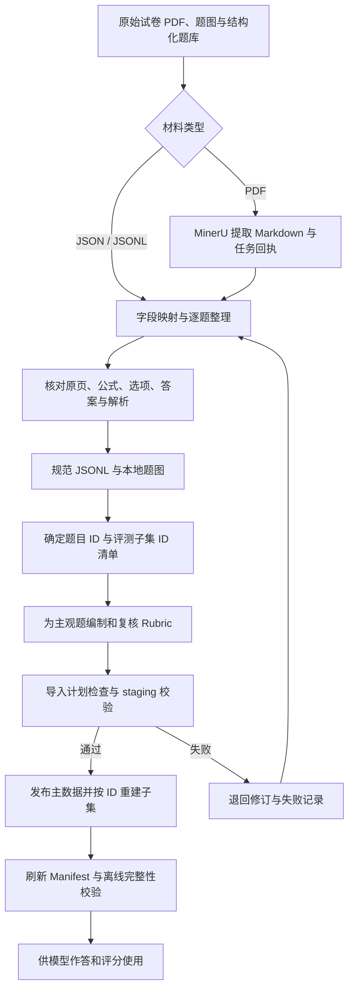

# 高考数学数据集构建流程

> 历史记录：文中轻量 API 方法已停止使用，原 tools 目录已删除。后续提取按 [网页端精准解析标准步骤](../../workspace/README.md#网页端精准解析标准步骤)执行；保留旧正文仅供追溯。

本文说明本项目从原始材料整理到规范数据发布的构建流程，供项目汇报、数据维护和流程复现使用。数据规模与程序行为按 **2026-10-13 本地文件核验结果**记录；该日期是文档核验日期，不代表数据采集日期。

本文以实际 JSONL、Schema 和脚本为依据。历史材料中出现的“140 道主集”“31 张图片”“四个顶层字段”等口径不适用于当前版本。原始下载包及部分处理脚本、中间材料已清理，因此当前仓库可以验证和维护现有数据，但不足以完整重放最初的采集过程。

## 1. 建设目标与当前成果

数据集面向大模型在中国高考数学任务中的能力评测，统一保存题干、选项、题图、标准答案和解析，并为主观题配套可解释的评分标准。构建时将规范题库、评测子集、处理中间文件和模型实验结果分别管理，避免同一题目的多个副本逐渐不一致。

| 数据资产 | 当前数量 | 组成与用途 |
|---|---:|---|
| Benchmark 主集 | 128 题 | 全部为 `gaokao` 来源，15 道题含图 |
| 训练集 | 1,000 题 | 566 道 GAOKAO-Bench 题、434 道 Conic10K 题；当前均无图 |
| 客观题子集 | 70 题 | 从 Benchmark 主集选取，50 道选择题、20 道填空题；62 道无图、8 道含图 |
| 主观题子集 | 50 题 | 36 道 Benchmark 高考题、14 道训练集 Conic10K 题；5 道含图 |
| 主观题评分标准 | 50 份 | 每题一份 Rubric，当前每份均有两种参考解法 |
| 规范题图 | 23 个文件 | 与正式题库引用一致，无缺失或未引用图片 |

Benchmark 主集包括 69 道选择题、23 道填空题、16 道解答题、12 道证明题、5 道综合题和 3 道压轴题。两个评测子集之间没有重复 ID。

上述数量不能简单相加：评测子集是从主集与训练集中派生的视图。尤其是主观题子集有 **14 题与训练集直接重叠**；若用该训练集训练模型，必须先隔离这些题，并进一步检查同题异 ID、近似题与答案泄漏，才能将主观题结果用于独立测试。当前 1,000 道训练题尚未逐题完成权威复核。

## 2. 总体流程



这是一条包含人工整理与审核的流程。现有工具负责 PDF 初步提取、规范记录导入、子集重建和完整性检查；没有覆盖“PDF 自动变成已审核题库”的全部步骤。

## 3. 原始材料收集与来源管理

### 3.1 数据来源

当前数据实际包含两类来源：高考数学题与 Conic10K 题。训练集的 GAOKAO-Bench / Conic10K 构成依据项目说明及当前来源统计记录。Schema 还预留了 `aime` 和 `university_exam`，但当前正式数据中没有这两类记录。

已有高考题 ID 涵盖 2015 年及 2021—2026 年，来源卷名保存在 `metadata.paper_name`。题目 ID 中的年份和地区是已有命名信息，不能替代完整的来源凭证。

### 3.2 工作区安排

| 路径（相对项目目录） | 职责 |
|---|---|
| `workspace/imports/` | 新批次原始输入、整理后的待导入题目和配套材料 |
| `workspace/extracted/` | MinerU Markdown、任务回执等提取中间结果 |
| `workspace/review/` | 待审核题目、来源信息和审核记录 |
| `workspace/staging/` | 正式发布前的临时数据 |
| `workspace/rejected/` | 规范化或 staging 校验失败报告 |
| `workspace/reports/` | 导入发布报告 |
| `datasets/`、`data/images/` | 正式发布的数据与题图 |

后续新增批次宜在审核记录中保留原始文件名、页码、题号、获取来源、修订原因和审核信息。正式题目 Schema 不接受这些额外字段，相关记录应单独保存；不能因规范 JSONL 没有保留这些字段，就将来源证据一并丢弃。

## 4. PDF 提取与逐题结构化

对于 PDF，使用 `tools/mineru/extract_with_mineru_flash.py` 调用远程解析服务。当前脚本上传指定 PDF，启用中文 OCR、公式和表格识别，保存两个主要产物：

- `<文件名>.md`：提取出的 Markdown。
- `<文件名>.receipt.json`：输入文件、任务 ID、请求选项及任务状态。

脚本支持 `--page-range` 指定页码范围。**它不会直接输出规范题目 JSONL，也不会自动完成题图下载、题目切分、答案关联和数学审核。** 需要在提取后逐题整理，或另行编写转换程序，再交给导入脚本。

整理时应将一道题的所有小问、必要题图、对应选项、最终答案和解题过程关联到同一条记录。含图题需准备本地图片文件，并验证其与题干对应；仅保留 Markdown 中的远程图片地址不能通过正式导入。

## 5. 内容清洗与数学复核

内容审核分为原页核对和数学复核两层。OCR 输出只作为录入辅助材料，不能直接当作标准答案。

| 检查对象 | 复核要点 |
|---|---|
| 题干 | 题号与小问是否完整；跨页内容是否漏接；条件是否缺失 |
| 数学公式 | 上下标、正负号、根号、分式、区间端点、向量和分段函数是否准确 |
| 选项 | 选项数量、标签与内容是否完整；答案标签是否对应正确选项 |
| 题图 | 几何标注、坐标轴、点名与文字是否清楚；图片是否属于该题 |
| 最终答案 | 是否与原始答案一致；是否遗漏多解、取值范围或多个小问 |
| 解题过程 | 是否满足题设；运算、逻辑及结论是否一致；是否存在无依据的补写 |
| 表达形式 | LaTeX 与 JSON 转义是否正确；等价表达规范化后是否保留原意 |

项目 README 记录了删除 10 道缺答案或需审核记录，以及 12 道无选项选择题的清理过程；当前主集实际为 128 题。该说明属于历史清理记录，当前仓库未保留足以完整重建全部删除过程的材料。

保留的 `datasets/subjective_50/review_records/MINERU_2026_CORRECTION_REPORT.json` 记录了部分原页复核、数学修订及答案格式规范化。例如，一道 Conic10K 题的答案由 `pm*4` 修订为 `$m=\\pm4$`。该报告含旧版路径及哈希，仅用于追溯当时修订，不能替代当前 Manifest。

对于缺条件、缺答案、无法核对或存在未解决数学争议的题，应保留在审核区，待问题解决后再发布。当前 Schema 只能验证数据结构，无法证明数学结论正确，也不会自动判定选择题选项是否充分。

## 6. 统一数据结构与图片规范

正式题目采用 UTF-8 JSONL，每行一个 JSON 对象，顶层严格保留五个字段：

| 字段 | 内容与约束 |
|---|---|
| `id` | 非空题目主键，用于题目、Rubric、模型答案和评分结果关联 |
| `source` | `gaokao`、`conic10k`、`aime`、`university_exam` 之一 |
| `question` | `text` 题干、`images` 图片路径数组、`options` 选项数组 |
| `answer` | 非空 `final_answer` 与非空 `solution` |
| `metadata` | `paper_name` 卷名、`question_type` 题型 |

下面是格式示例，非正式数据中的题目；实际保存时应写成一行：

```json
{
  "id": "gaokao_demo_001",
  "source": "gaokao",
  "question": {
    "text": "已知集合 $A=\\{1,2\\}$，$B=\\{2,3\\}$，求 $A\\cap B$。",
    "images": [],
    "options": []
  },
  "answer": {
    "final_answer": "$\\{2\\}$",
    "solution": "两个集合共同的元素只有 2，因此交集为 $\\{2\\}$。"
  },
  "metadata": {
    "paper_name": "格式示例",
    "question_type": "填空题"
  }
}
```

导入脚本优先使用输入的 `source`，否则尝试依据既有 ID 前缀推断，最后使用 `--source` 提示值。缺少 ID 时，按“来源 + 年份或 undated + 题干 SHA-256 前 8 位”生成。这里的哈希仅用于生成 ID，不构成语义去重；自动 ID 也不包含答案、选项和图片信息。

规范化只保留上述规定字段。输入 `metadata.year` 可参与自动 ID 生成，但不会写入正式 `metadata`；来源页码、审核状态等同样需要在独立记录中保存。

新增图片会复制为 `data/images/<来源>/<题目ID>_<序号>.<扩展名>`，题目中保存相对项目目录的路径。正式数据不接受外部 URL。发布前需检查所有引用图片均存在，且正式图片目录没有未引用文件。

## 7. 评测子集与主观题评分标准

### 7.1 固定评测子集

`datasets/objective_70/questions.jsonl` 和 `datasets/subjective_50/questions.jsonl` 直接保存固定子集，成员和顺序以各文件中的 ID 与行顺序为准。独立名单及自动重建工具已移除。

当前客观题子集全部来自 Benchmark；主观题子集来自 Benchmark 的 36 道题及训练集的 14 道 Conic10K 题。导入不会重写子集或其评分标准，校验仍检查子集记录与对应主库记录一致。

现有仓库没有可重放的初始抽样脚本、随机种子或分层配额记录，因此不能将这两个子集描述为已验证的随机抽样或难度均衡抽样结果。

### 7.2 编制与复核 Rubric

每道主观题通过 `question_id` 对应一份评分标准。当前格式为纯文本评分标准和参考解法，字段如下：

| 字段 | 含义 |
|---|---|
| `question_id` | 对应题目 ID |
| `rubric` | 知识点、评分要点、部分得分条件、等价解法及常见错误说明 |
| `reference_solution_1` | 第一种完整参考解法，必填 |
| `reference_solution_2` | 第二种参考解法；Schema 允许省略或为 null，当前 50 份均已填写 |

Rubric 使用统一 **20 分实验尺度**，不等于原试卷官方分值。审核应核对评分内容与当前题干一致、分值安排合理、部分得分规则明确、两种解法正确且不是重复文本。题干、答案或解析修改后，要同步复核对应 Rubric。

历史汇报材料记载旧版 Rubric 经模型辅助生成与人工审核；当前规范文件已不含完整的生成模型、提示版本或审核人信息。现有纯文本 Schema 也不能自动证明各评分要点分值相加为 20，相关工作仍需内容审核。不要将旧版结构化 `scoring_items` 的校验能力描述为当前格式已有能力。

## 8. 规范导入与发布

`scripts/maintenance/import_dataset.py` 的当前执行顺序如下：

1. 读取指定 JSON / JSONL 输入，加载现有主集、训练集和 Rubric。
2. 规范化字段、识别来源、生成或检查 ID，并规划题图复制。
3. 检查新增 ID 是否重复、必要内容是否缺失；新增主观题必须提供对应 Rubric。
4. 若使用 `--dry-run`，输出计划及此前发现的问题，不写文件并退出。
5. 正式执行时写入 staging，校验 Schema、跨库 ID、子集 ID 引用、Rubric 关联、外部 URL 和图片可用性。
6. 校验通过后复制图片，以 `os.replace` 逐文件替换主集、训练集和 Rubric。
7. 保持固定子集及其评分标准不变，刷新 Manifest，运行发布后完整性检查并输出导入报告。

使用时需准确理解以下边界：

- **dry-run 是初步计划检查。** 它在 staging 校验前退出，成功不代表所有 Schema、子集关联与发布检查均已通过。
- **目录输入会递归扫描 JSON / JSONL。** 不要把含 Rubric、任务回执等文件的整个目录直接作为题目输入；优先明确传入题目文件，再单独使用 `--rubrics`。
- **固定子集不会随导入扩充。** 新增主观题仍需要 `--rubrics` 提供评分标准进行验证；这些新增评分标准随导入报告保存，不追加至固定的50条评分标准。
- **发布不是多文件事务。** 规范化或 staging 校验失败时不进入正式发布；但图片复制、多次替换与最终校验之间没有整体回滚。发布后校验失败返回码为 2，此时应检查报告并修复或恢复备份，不能假定正式文件未变。

## 9. 操作命令

以下 PowerShell 命令均从项目父目录 `D:\codex-project\高考数据集` 执行。输入文件名为示例，运行前需准备对应文件。本文编写过程中只运行了离线校验，没有执行上传、导入或重新生成正式题目。

### 9.1 环境准备

已有可用 `.venv` 时可复用；首次安装时执行：

```powershell
python -m venv .venv
.venv\Scripts\python.exe -m pip install -r CampusEval\requirements.txt
```

### 9.2 PDF 初提取（按需）

该命令会上传指定 PDF 至远程服务。服务可用性未在本次文档编写中联网验证。

```powershell
.venv\Scripts\python.exe CampusEval\tools\mineru\extract_with_mineru_flash.py `
  "CampusEval\workspace\imports\paper.pdf" `
  --output-dir "CampusEval\workspace\extracted\paper" `
  --timeout 600
```

提取后完成逐题结构化和复核，准备题目 JSONL 与本地图片。

### 9.3 新增客观题：预览与导入

以下示例要求 `questions.jsonl` 仅包含本批新增客观题，且具有完整答案与解析：

```powershell
.venv\Scripts\python.exe CampusEval\scripts\maintenance\import_dataset.py `
  --imports CampusEval\workspace\imports\batch\questions.jsonl `
  --target main --source gaokao --dry-run

.venv\Scripts\python.exe CampusEval\scripts\maintenance\import_dataset.py `
  --imports CampusEval\workspace\imports\batch\questions.jsonl `
  --target main --source gaokao
```

导入训练集时将 `--target main` 改为 `--target training`。主观题评分标准的验证与保存方式见第 8 节。

### 9.4 手工修订后的 Manifest 更新

固定子集不再重新生成。确认正式文件及图片一致后，可调用 Manifest 更新函数记录有意修订的版本，不能通过刷新哈希掩盖不明的数据变化：

```powershell
@'
from pathlib import Path
from CampusEval.scripts.maintenance.import_dataset import read_jsonl, refresh_manifest

root = Path("CampusEval").resolve()
main = read_jsonl(root / "datasets/main/benchmark.jsonl")
training = read_jsonl(root / "datasets/main/training.jsonl")
rubrics = read_jsonl(root / "datasets/subjective_50/rubrics.jsonl")
mini_counts = {
    name: len(read_jsonl(root / "datasets" / name / "questions.jsonl"))
    for name in ("objective_70", "subjective_50")
}
refresh_manifest(root, main, training, rubrics, mini_counts)
'@ | .venv\Scripts\python.exe -
```

最后运行离线校验：

```powershell
.venv\Scripts\python.exe CampusEval\scripts\maintenance\validate_clean_release.py
```

## 10. 发布验收与版本管理

发布时应同时检查内容审核记录和程序校验报告。`validate_clean_release.py` 主要核验：

- 五个规范 JSONL 的记录数、各文件内 ID 唯一性与 Manifest 哈希一致性。
- 题目及 Rubric 是否满足各自 Schema，题目中是否含外部 URL。
- 子集记录是否与对应主库记录完全一致。
- 主观题与 Rubric 的 ID 集合是否一致，评分标准及第一解法是否非空，两种解法是否为完全相同的文本。
- 题图是否存在、是否有未引用图片，以及图片文件总数是否匹配 Manifest。

2026-10-13 实际运行结果为 `ok: true`：128 道主集、1,000 道训练题、70 道客观题、50 道主观题及 50 份 Rubric 通过校验；23 个图片引用完整，错误列表为空。当时另行比对了两个子集的历史名单与记录顺序，结果一致；Benchmark 与训练集之间无相同 ID。

这些结果证明当前版本结构及引用一致，**不等于逐题数学正确性、内容去重或独立测试无泄漏的证明**。当前子集的顺序直接以题目文件中的行顺序为准。

`datasets/RELEASE_MANIFEST.json` 记录五个规范 JSONL 的路径、字节数与 SHA-256，以及数据和图片数量；目前不覆盖每张图片内容、ID 清单和所有来源材料的哈希。建议每次发布同时归档这些文件及审核记录，以便定位题目修订与评测结果的版本关系。

## 11. 与模型评测衔接

完成发布后，模型答案通过题目 ID 与数据集关联。客观题可进入答案匹配与重评分流程；主观题由题目、Rubric、参考解法和被测答案共同构成评分输入，再进行多 Judge 评分、聚合及分歧复核。

历史正式实验保存在 `reports/`，新增运行写入 `runs/`。修改标准答案或评分标准后，应记录所用数据版本，并判断是否需要对历史答案重新评分；不能直接把不同数据版本的成绩视为同口径结果。具体评测协议见 [EVALUATION.md](01_基础评测协议_v2.md)。

## 12. 本文依据

| 文件 | 用途 |
|---|---|
| [项目 README](../../README.md) | 当前发布概况与历史清理说明 |
| [Manifest](../../datasets/RELEASE_MANIFEST.json)、[校验报告](../../datasets/VALIDATION_REPORT.json) | 当前数量、哈希与校验结果 |
| [题目 Schema](../../schemas/dataset.schema.json)、[Rubric Schema](../../schemas/subjective_rubric.schema.json) | 正式结构约束 |
| [导入脚本](../../scripts/maintenance/import_dataset.py) | 规范化、staging、发布和 Manifest 更新的实际行为 |
| [离线校验脚本](../../scripts/maintenance/validate_clean_release.py) | 发布检查范围 |
| MinerU 轻量工具（历史工具已删除） | PDF 上传、Markdown 与任务回执输出 |
| 历史修订记录（历史路径：`datasets/subjective_50/review_records/MINERU_2026_CORRECTION_REPORT.json`；归档时该文件已不存在） | 部分题目的复核与修订证据 |

数据构成、含图题数量、子集与训练集重叠关系均直接统计自当前正式 JSONL。历史汇报材料仅作背景参考，未将其中已过期的规模和评分格式作为当前事实。
